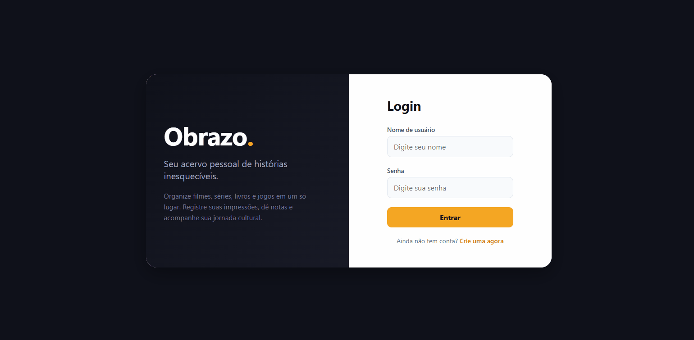
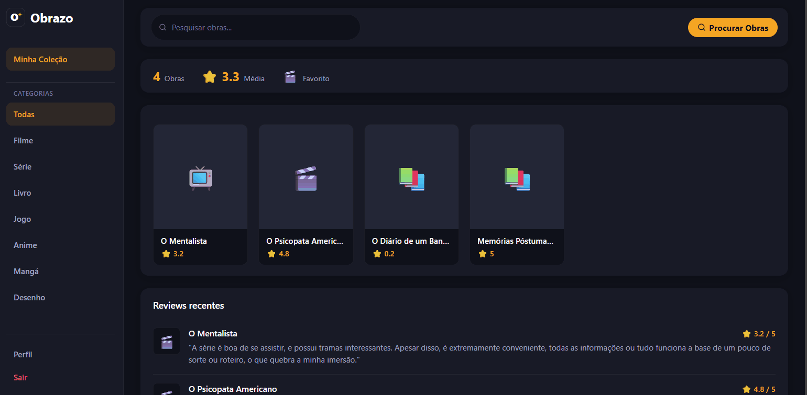
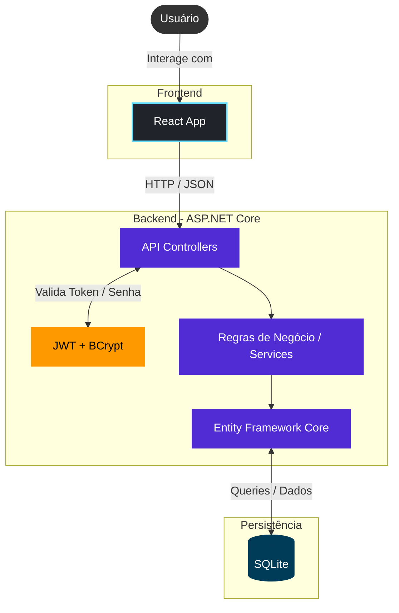
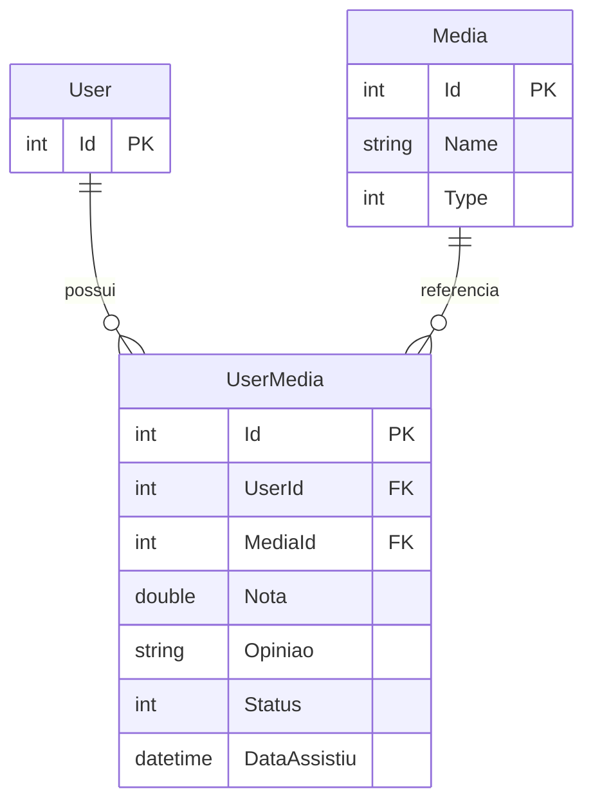

# Obrazo


O **Obrazo** é uma plataforma web desenvolvida para organizar coleções pessoais de obras de entretenimento, permitindo registrar avaliações, opiniões, status e datas de consumo. Seu objetivo é preservar as experiências e memórias dos usuários relacionadas a filmes, séries e outras mídias. A API do projeto foi desenvolvida em C# com .NET 10, enquanto o front-end foi desenvolvido com React.


*Tour rápido pela interface do Obrazo*

---
## Sobre o Projeto

O projeto nasceu de um pensamento cotidiano, a sensação de já ter visto algo, mas não se lembrar exatamente qual obra é, nem como ela era. Para resolver isso, me propus a criar uma plataforma, na qual eu seria capaz de armazenar meus comentários, minhas avaliações, o status de uma obra e quando a consumir.

---
### Funcionalidades

Para concretizar o projeto, foram desenvolvidas as seguintes funcionalidades:
- Gerenciamento de obras e coleções pessoais (CRUD)
- Gerenciamento de usuários (cadastro e login).
- Proteção de credenciais utilizando JWT e BCrypt.
- Busca e filtragem por nome e categoria.
- Diferentes interfaces para as obras públicas e as avaliações privadas dos usuários.


*Dashboard do usuário*

---
### Stack Técnica:
- Backend: **C# / .NET 10 / ASP.NET Core / Entity Framework Core / SQLite**
- Frontend: **React**
- Segurança: **JWT e BCrypt**

---
## Arquitetura

O projeto utiliza uma arquitetura em camadas, separando a interface do usuário (Frontend) da lógica de negócios e persistência (Backend).



**Fluxo da aplicação:**
1. O usuário interage com a interface em **React**.
2. As requisições são enviadas via HTTP para a **API em .NET 10**.
3. A API valida o acesso via **JWT** e protege as senhas com **BCrypt**.
4. Os dados são processados e persistidos via **EF Core** no banco **SQLite**.

---
## Como Executar

### Pré-requisitos

Antes de começar, você vai precisar ter instalado em sua máquina as seguintes ferramentas:

*   **[Git](https://git-scm.com/)** (para clonar o repositório)
*   **[.NET 10 SDK](https://dotnet.microsoft.com/download/dotnet/10.0)** (para rodar a API e o Entity Framework)
*   **[Node.js](https://nodejs.org/)** (versão 18.x ou superior) e **NPM** (para rodar o frontend React)
*   Um editor de código de sua preferência, como **[Visual Studio](https://visualstudio.microsoft.com/)**, **[VS Code](https://code.visualstudio.com/)** ou **[Rider](https://www.jetbrains.com/rider/)**.

> **Sobre as dependências:**
> *   **React** e **Entity Framework Core** não precisam ser instalados manualmente na sua máquina; eles serão baixados automaticamente para dentro do projeto quando você rodar os comandos `npm install` (frontend) e `dotnet restore` (backend).
> *   Se você precisar rodar comandos de migração do banco de dados, instale a ferramenta do EF Core com: `dotnet tool install --global dotnet-ef`

> **Nota sobre o Banco de Dados:** O projeto utiliza o **SQLite**. Não é necessário instalar nenhum servidor de banco de dados, pois o EF Core gerencia o arquivo localmente. *(Opcional: Caso queira visualizar os dados, você pode usar o [DB Browser for SQLite](https://sqlitebrowser.org/)).*

---

### Como rodar o projeto (Passo a Passo)

**1. Clone o repositório:**
```bash
git clone https://github.com/rallantro/obrazo.git
cd obrazo
```

**2. Rodando o Backend (API .NET):**
```bash

# Restaure as dependências e aplique as migrations do banco
dotnet restore
dotnet ef database update

# Inicie o servidor
dotnet run
```
*A API estará rodando em `http://localhost:5000` (ou a porta que estiver no seu `launchSettings.json`).*

**3. Rodando o Frontend (React):**
Abra um **novo terminal** e execute:
```bash
# Navegue até a pasta do frontend
cd obrazo-frontend

# Instale as dependências
npm install

# Inicie a aplicação
npm run dev
```
*O frontend estará acessível em `http://localhost:5173` (ou a porta indicada no terminal).*

---
## Detalhes de Implementação

<details>
  <summary><b>Sistema de Autenticação e Segurança</b></summary>
  <p>A segurança da API foi construída utilizando o modelo <i>Stateless</i> com JSON Web Tokens (JWT) e hash de senhas com BCrypt.</p>
  
  <b>1. Cadastro e Proteção de Senhas (BCrypt):</b><br>

  Ao se cadastrar, o usuário envia a senha em texto puro (via HTTPS). A API utiliza o algoritmo <b>BCrypt</b> para gerar um hash seguro da senha antes de salvar no banco. O BCrypt foi escolhido por aplicar um "salt" automático e ser lento por design, o que dificulta ataques de força bruta.
  
  <b>2. Validação de Dados (Data Annotations):</b><br>

  A entrada de dados é validada utilizando <i>Data Annotations</i> nos DTOs (ex: a senha precisa ter no mínimo 6 caracteres e conter pelo menos 1 número).
  
  <b>3. Login e Geração do Token (JWT):</b><br>

  No login, a API busca o usuário e usa o método <code>BCrypt.Verify()</code> para comparar a senha digitada com o hash salvo. Se as credenciais forem válidas, o <code>TokenService</code> gera um JWT assinado usando o algoritmo HMAC SHA-256, contendo o ID do usuário e um tempo de expiração de 1 hora.
  
  <b>4. Nota sobre a Chave de Assinatura (Demonstração):</b><br>

  A chave secreta (<code>Key.cs</code>) está no código apenas para fins de demonstração e facilidade de execução do projeto. Em um ambiente de produção real, essa chave seria movida para <i>Variáveis de Ambiente</i> ou <i>User Secrets</i> do .NET, garantindo que credenciais não vazem no controle de versão.
</details>

<details>
  <summary><b>O uso de DTOs (Data Transfer Objects)</b></summary>
  <p>Em vez de expor as entidades do banco de dados diretamente na API (como a classe <code>User</code>), o projeto utiliza DTOs específicos para cada requisição (ex: <code>LoginRequest</code> e <code>RegisterRequest</code>).</p>
  
  <b>1. Segurança (Proteção de Dados Sensíveis):</b><br>

  A entidade <code>User</code> possui a propriedade <code>PasswordHash</code>. Se ela fosse usada diretamente na API, haveria o risco de vazar o hash da senha em respostas. Os DTOs garantem que apenas os dados estritamente necessários (nome e senha) trafeguem na requisição.
  
  <b>2. Validação Isolada:</b><br>

  Os DTOs permitem aplicar regras de validação específicas (via Data Annotations) sem poluir a entidade de domínio. Por exemplo, o <code>RegisterRequest</code> exige senha mínima de 6 caracteres e pelo menos 1 número, enquanto o <code>LoginRequest</code> apenas exige que a senha não esteja vazia.
  
  <b>3. Flexibilidade:</b><br>

  Se houver qualquer alteração nas regras de transmissão do conteúdo do front-end, como novos requisitos para senhas, a alteração pode ser realizada apenas no DTO, sem a necessidade de alterar a tabela do banco de dados.
</details>

<details>
  <summary><b>Base de Dados</b></summary>
  <p>As consultas ao banco de dados <code>SQLite</code> são realizadas utilizando <i>LINQ</i> integrado ao <i>Entity Framework Core</i>. Essa abordagem permite expressar operações de consulta diretamente em <i>C#.</i></p>

  <b>1. SQLite</b>
  <p> Esse banco foi escolhido, principalmente pela sua leveza e portabilidade. Afinal, ao não exigir um servidor de banco de dados à parte, este banco permite que a plataforma armazene os dados localmente, com baixo custo operacional e de desempenho, além de facilitar a distribuição do projeto.</p>

  <b>2. Modelagem e Relacionamento entre Tabelas</b>
  <b>Diagrama de Relacionamento</b>
  <p>O banco possui três entidades principais: <code>User</code>, <code>Media</code> e <code>UserMedia</code>.</p>

<p>A tabela <code>Media</code> armazena o catálogo de obras cadastradas na plataforma, enquanto <code>UserMedia</code> representa a associação entre usuários e obras, armazenando informações individuais, como avaliações, opiniões e status.</p>

<p>Essa separação permite que diferentes usuários adicionem e avaliem a mesma obra sem duplicar suas informações cadastrais. O relacionamento é estabelecido por meio de chaves estrangeiras (<i>Foreign Keys</i>), que referenciam as chaves primárias (<i>Primary Keys</i>) das respectivas entidades.</p>



<b>3. Exclusão em Cascata</b>

<p>Os relacionamentos configurados no <i>AppDbContext</i> utilizam o comportamento <code>DeleteBehavior.Cascade</code>. Isso significa que, ao excluir um usuário ou uma obra, os registros correspondentes em <code>UserMedia</code> (as avaliações dos usuários) também são removidos automaticamente pelo banco de dados, preservando a integridade referencial e evitando registros associados a entidades inexistentes.</p>

</details>

---
## Roadmap

Existem muitas melhorias a serem feitas no projeto. Por isso, deixo aqui os próximos passos para tornar a plataforma e o projeto em si cada vez melhor:

### Próximos Passos:
#### Prioridades:
- **Testes Automatizados:** Implementar testes unitários (provavelmente xUnit) para a API.
- **Deploy e CI/CD:** Configurar pipeline de CI/CD (GitHub Actions) para rodar testes e build.
#### Melhorias de UX:
- **Upload de Imagens:** Permitir que o usuário faça um upload de pôsteres ou capas das obras. 
- **Modo Escuro / Modo Claro:** Permitir ao usuário alternar entre o esquema de cores da plataforma. 
- **Sistema de Favoritos** Permitir ao usuário marcar obras como favoritas.
- **Lista de Desejos:** A API e o Banco de dados já possuem uma categoria de obras "Desejadas", mas estas não estão separadas das demais avaliações, assim, criar uma seção preparada para a lista de desejos.
#### Melhorias de Segurança:
- **Refresh Token:** Implementar mecanismos de Refresh Token para a renovação segura da sessão JWT.
- **Rate Limiting:** Adicionar limitação de requisições na API para prevenir abusos.

---
## Licença

Este projeto está licenciado sob a **MIT License** – consulte o arquivo [LICENSE](LICENSE) para mais detalhes.

A licença MIT é uma licença permissiva e de código aberto que permite que qualquer pessoa utilize, copie, modifique, distribua e até mesmo utilize o código em projetos comerciais, desde que mantenham os créditos originais (aviso de copyright e a própria licença).

> **Nota:** Este projeto foi desenvolvido para fins educacionais e de portfólio. O código é fornecido "como está", sem garantias de qualquer tipo.

---

## Autor

**Ronaldo Allan**  
Desenvolvedor | C# / .NET | APIs REST & SQL 

[](https://www.linkedin.com/in/ronaldovrocha/)  [](https://github.com/rallantro/)